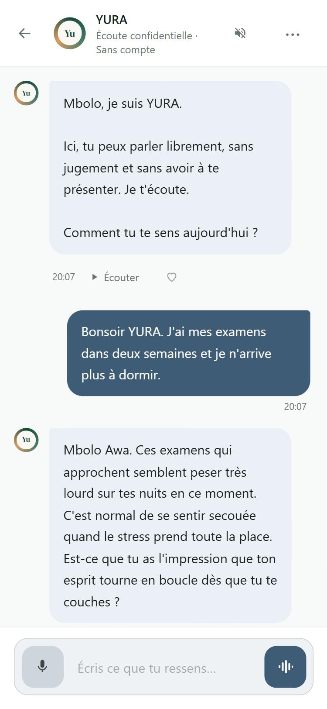
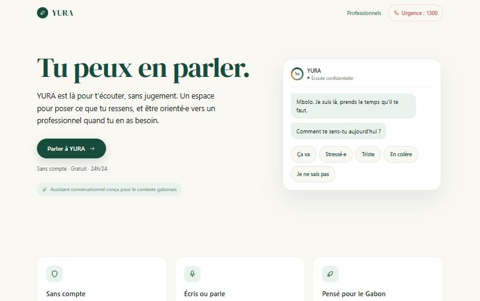
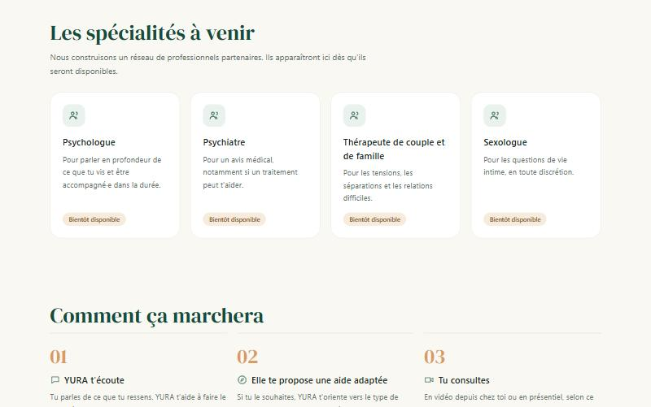

# YURA

**Tu peux en parler.** YURA est une compagne d'écoute émotionnelle pensée pour le Gabon : un espace pour poser ce que l'on ressent, sans jugement et sans compte, à l'écrit ou à voix haute, avec une orientation vers des professionnels quand c'est nécessaire.

En ligne : **https://yura-rust.vercel.app**

> Prototype présenté au Concours Art Numérique · Gabon 2026. YURA ne remplace pas un professionnel de santé. En cas de danger immédiat : **1300**.

## Aperçu

| Accueil (mobile) | Conversation | Mode vocal |
|---|---|---|
|  |  |  |

| Accueil (ordinateur) | Professionnels |
|---|---|
|  |  |

## Fonctionnalités

- **Conversation en streaming** : la réponse s'affiche mot par mot dès la première seconde.
- **Mode vocal mains libres** : YURA écoute, répond à voix haute, puis réécoute. Envoi automatique après 1,5 s de silence. Si tu parles pendant qu'elle parle, elle se tait (l'écho de sa propre voix est ignoré). Un orbe lumineux réagit à sa voix.
- **Voix instantanée** : chaque phrase est lue dès qu'elle est complète, pendant que la suite s'écrit (premier son vers 2 s). Voix du navigateur par défaut (meilleure voix française disponible), Gemini TTS en option.
- **Longues conversations** : les 20 derniers messages sont envoyés en entier, les plus anciens sont résumés (prénom, situation, émotions). Testé sur 30 messages et plus.
- **Couleurs émotionnelles** : l'interface change doucement de teinte selon l'état détecté (calme, anxiété, tristesse, colère, joie, crise).
- **Sécurité** : protocole de crise, bandeau d'appel au 1300, exercices guidés (respiration 4-4-6, ancrage 5-4-3-2-1, défusion).
- **Sans compte** : l'historique reste dans le navigateur ; rien n'est conservé côté serveur.
- **Ancrage culturel** : proverbes et repères gabonais, « Mbolo ».
- **Mobile d'abord** : responsive de 375 px au grand écran, cibles tactiles de 44 px minimum, installable (PWA).

## Pile technique

| Élément | Choix |
|---|---|
| Framework | Next.js 16 (App Router, Turbopack), React 19, TypeScript strict |
| Modèle de conversation | **Gemma 4 26B** (`gemma-4-26b-a4b-it`) via l'API Gemini, réflexion désactivée ; secours automatique sur **Gemini 2.5 Flash** |
| Voix | Web Speech API (défaut) ou Gemini TTS ; reconnaissance vocale Web Speech (fr-FR) |
| Orbe du mode vocal | Three.js (shader WebGL) |
| Hébergement | Vercel, avec Vercel Web Analytics (sans cookie) |

Aucune base de données : l'historique et le résumé sont stockés dans le navigateur (`localStorage`).

### Comment une réponse est produite

1. Le navigateur envoie les 20 derniers messages et le résumé des plus anciens à `/api/chat`.
2. Le serveur appelle Gemma 4 en streaming. Si aucun mot n'arrive en 12 s, en cas de quota (429), d'erreur ou de réponse vide, il bascule sur Gemini Flash sans que l'utilisateur ne voie d'erreur.
3. Un filtre retient tout ce qui suit une accolade : les balises cachées (`{"emotion": …}`, `{"exercice": …}`) ne s'affichent jamais, même un instant. Les tirets longs deviennent des virgules.
4. Le flux est relayé au navigateur (NDJSON). Chaque phrase complète part à la voix si la lecture est active.
5. À la fin, l'émotion et l'exercice éventuel sont appliqués ; le résumé est mis à jour en arrière-plan tous les 6 messages.

En cas d'échec, aucun message d'erreur n'est sauvegardé : un bouton « Réessayer » apparaît.

## Performances mesurées

Mesures du 27 octobre 2026 sur une conversation simulée de 30 messages (Gemma 4 26B, niveau gratuit).

| Mesure | Résultat |
|---|---|
| Premier mot affiché (médiane) | **1,15 s** |
| Premier son (lecture automatique) | **~2,0 s** |
| Taille d'une requête (tokens d'entrée) | plafonne vers **2 600** |
| Balises cachées visibles | **0** |

Taille des requêtes avant et après l'allègement du prompt et le résumé :

| Messages dans la conversation | Avant | Après |
|---|---|---|
| 2 | 4 814 | 1 487 |
| 20 | 5 472 | 2 145 |
| 60 | 6 941 | 2 248 |

### Quotas gratuits (projet AI Studio, octobre 2026)

| Modèle | Requêtes/min | Tokens/min |
|---|---|---|
| Gemma 4 26B | 30 | 16 000 |
| Gemini 2.5 Flash (secours) | 5 | 250 000 |
| Gemini 3.8 Flash TTS | 3 | 10 000 |

Avec ~2 500 tokens par requête, Gemma tient environ 6 messages par minute ; au-delà, la bascule sur Flash prend le relais. Gemini TTS en gratuit est trop limité pour une conversation entière : la voix du navigateur est donc utilisée par défaut.

## Démarrer en local

Prérequis : Node.js 22.18 ou plus récent (24 recommandé, nécessaire pour `npm test`), et une clé API Gemini ([AI Studio](https://aistudio.google.com/apikey)).

```bash
npm install
```

Crée un fichier `.env.local` à la racine (voir `.env.example`) :

```bash
GEMINI_API_KEY=ta_cle_api
```

Puis :

```bash
npm run dev
```

Ouvre http://localhost:3000.

```bash
npm test
```

44 tests unitaires (Node test runner, sans dépendance) : filtre des balises, découpage en phrases, nettoyage du texte avant lecture, résumé, écho du micro, conversion audio.

## Variables d'environnement

| Variable | Obligatoire | Défaut | Rôle |
|---|---|---|---|
| `GEMINI_API_KEY` | oui | | Clé de l'API Gemini (conversation, résumé, voix Gemini) |
| `LLM_MODEL` | non | `gemma-4-26b-a4b-it` | Modèle de conversation (option : `gemma-4-31b-it`) |
| `LLM_FALLBACK_MODEL` | non | `gemini-2.5-flash` | Modèle de secours |
| `NEXT_PUBLIC_TTS_PROVIDER` | non | `webspeech` | `webspeech`, `auto` (Gemini si configuré) ou `gemini` |
| `GEMINI_TTS_MODEL` | non | | Modèle Gemini TTS, ex. `gemini-3.8-flash-lite-tts` |
| `GEMINI_TTS_VOICE` | non | | Voix Gemini TTS, ex. `Vindemiatrix` |
| `TTS_DAILY_CHAR_LIMIT` | non | `15000` | Plafond de caractères lus par jour et par utilisateur |
| `NEXT_PUBLIC_FEEDBACK_URL` | non | | Webhook Google Sheets pour l'avis de fin de conversation (voir `docs/setup-feedback.md`) |

Sur Vercel, seule `GEMINI_API_KEY` est indispensable : les autres ont des valeurs par défaut.

## Déploiement

Le projet est relié à Vercel : chaque push sur `main` déploie la production.

## Structure

```
app/
  page.tsx                 accueil
  chat/                    conversation
  teleconsultation/        page Professionnels
  about/, privacy/         À propos, Confidentialité
  dev/voices/              comparaison des voix (développement uniquement)
  api/chat/                réponse en streaming (Gemma 4 + secours)
  api/summary/             résumé des échanges anciens
  api/tts/                 voix Gemini (un bloc ou streaming)
components/
  ChatWindow.tsx           interface de conversation
  voice/                   mode vocal et orbe lumineux
  site/                    en-tête, pied de page, icônes
lib/
  llm/                     appel du modèle, filtre des balises, fenêtre et résumé
  tts/                     lecteur vocal, découpage en phrases, nettoyage du texte
  voice/                   reconnaissance vocale, filtre d'écho
  yuraSystemPrompt.ts      personnalité et règles de sécurité de YURA
```

## Confidentialité et limites

- Les messages sont transmis à l'API Google Gemini pour générer les réponses ; YURA ne les enregistre pas côté serveur et ne journalise jamais leur contenu.
- **En niveau gratuit, Google peut utiliser les contenus envoyés pour améliorer ses produits.** Pour un usage réel avec des confidences de santé mentale, il faut activer la facturation du projet.
- La reconnaissance vocale passe par le navigateur (Chrome, Edge, Safari), qui peut utiliser les serveurs de son éditeur.
- YURA est un prototype : elle ne pose pas de diagnostic et ne remplace pas un professionnel.
